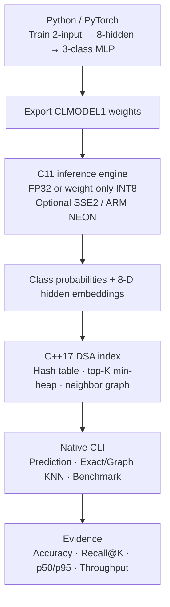
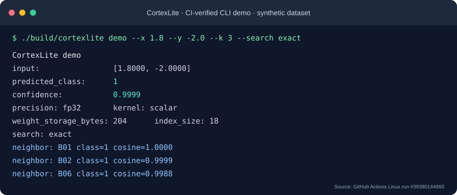
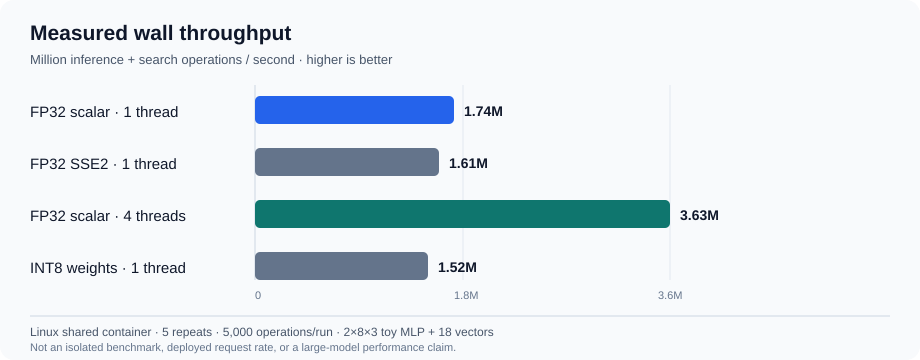

# CortexLite
[](https://github.com/naim-munshi/cortexlite-ai-engine/actions/workflows/ci.yml)

**A C11 + C++17 AI inference and vector-search engine, backed by a PyTorch-trained model and reproducible benchmarks.**

CortexLite demonstrates a complete, inspectable pipeline: **train a small model in Python, run inference without Python in C, generate hidden-layer embeddings, and retrieve nearest neighbors using custom C++ data structures.** It is a focused **CPU AI systems and DSA portfolio project**, not a production LLM server or vector database.

**Start here:** [Run a local demo](#run-it-yourself) · [Measured performance](#measured-results) · [Technical reviewer brief](docs/portfolio-brief.md) · [Source code tour](#source-code-tour)

## What this project demonstrates

| Language | Actual engineering work | Inspect the implementation |
|---|---|---|
| **C11 — inference core** | Model weights and memory ownership; FP32 matrix operations, softmax/ReLU; optional SSE2/NEON; per-row INT8 weight quantization | [inference.c](src/c/inference.c) · [tensor.c](src/c/tensor.c) |
| **C++17 — DSA and orchestration** | Custom open-addressing hash map, top-K min-heap, adjacency graph, exact/approximate nearest-neighbor search, multithreaded benchmark | [vector_index.cpp](src/cpp/vector_index.cpp) · [main.cpp](src/cpp/main.cpp) |
| **Python / PyTorch — model development** | Deterministic model training, portable weight export, FP32 numerical parity check, repeated benchmark data collection | [train_model.py](python/train_model.py) · [verify_parity.py](python/verify_parity.py) · [run_benchmarks.py](scripts/run_benchmarks.py) |
| **Build / GitHub Actions** | CMake or compiler-only build, seven native regression/integration checks, independent Python reference verification, Linux/macOS CI and ASan/UBSan validation | [CMakeLists.txt](CMakeLists.txt) · [native build](scripts/build-native.sh) · [CI](.github/workflows/ci.yml) |

## End-to-end architecture



**Why three languages?** Python is the training/evaluation tool, **C** is the low-level neural-network execution layer, and **C++** manages vector indexing, search algorithms and parallel operation execution. The final executable does **not** require Python or a GPU.

## See it working

The following output comes from an actual [Linux GitHub Actions run](https://github.com/naim-munshi/cortexlite-ai-engine/actions/runs/39380144660) using the checked-in sample model, **not** from invented results or a hosted service.



```bash
./build/cortexlite demo --x 1.8 --y -2.0 --k 3 --search exact
```

The program returns the predicted class, softmax confidence, precision/kernel configuration, model parameter storage and three cosine nearest neighbors. It supports `demo`, `evaluate`, and `benchmark` commands.

## Measured results

**Observed median values across five runs per configuration**, collected on a **shared Linux x86_64 container** (2026-10-20). The inference/throughput study uses a **2×8×3 toy MLP** and an **18-vector index**; numbers do not represent deployed service requests or large-model inference.

| Compared conditions | Observation | Interpretation |
|---|---:|---|
| FP32, scalar, **4 threads vs 1** | **2.09×** wall throughput | 3.63M vs 1.74M repeated operations/s on this host; not guaranteed elsewhere |
| Weight-only **INT8 vs FP32** | **37.3%** less model parameter storage | 128 vs 204 bytes; activations/biases remain FP32 |
| **SSE2 vs scalar**, 1 thread | **0.92×** throughput | SIMD was slower for this tiny network |
| **INT8 vs FP32**, 1 thread | **0.87×** throughput | Storage savings did not produce a speedup |
| Approximate graph search, **ef=64** | **95.2% Recall@10** | Against exact top-10 on **1,000 synthetic 32-D vectors / 100 queries** |



**Evidence:** [Full benchmark analysis](docs/results.md) · [35 raw measurement records (CSV)](reports/benchmarks-linux-container.csv) · [Raw JSON and host metadata](reports/benchmarks-linux-container.json) · [Reproduction protocol](docs/benchmarks.md). Latency and speed measurements are especially sensitive to noisy shared hosts; the report includes negative results and limitations.

## Run it yourself

**Requirements:** C11 and C++17 compilers on Linux or macOS; Python 3 for the bundled validation and benchmark scripts. CMake ≥3.16 is optional: when absent, the showcase automatically builds with the system C/C++ compilers. There is no Homebrew, Docker, GPU, API key or account requirement.

The fastest complete walkthrough builds the project, runs **all seven tests**, prints a real prediction and compares exact versus approximate search:

```bash
git clone https://github.com/naim-munshi/cortexlite-ai-engine.git
cd cortexlite-ai-engine
bash scripts/showcase.sh
```

**Mac without CMake or Homebrew:** The same `bash scripts/showcase.sh` detects the missing CMake command and compiles directly using the Apple Command Line Tools (`cc`, `c++`). To force/test that path on any machine:

```bash
CORTEXLITE_FORCE_NATIVE=1 bash scripts/showcase.sh
```

That route compiles into `build-native/`, executes the seven equivalent native test cases, checks accuracy, runs an independent **Python standard-library** reference comparison against the C inference output, then shows the CLI demo. `python/verify_parity.py` remains available for optional PyTorch-backed cross-checks.

**Homebrew SSL/certificate problem?** Read [macOS setup & secure troubleshooting](docs/macos-setup.md). The no-CMake path does not require disabling certificate verification.

Alternatively, use the normal CMake workflow:

```bash
cmake -S . -B build -DCMAKE_BUILD_TYPE=Release
cmake --build build --parallel 2
ctest --test-dir build --output-on-failure
./build/cortexlite demo
./build/cortexlite benchmark --precision fp32 --kernel scalar --threads 4 --iterations 5000
./build/cortexlite_vector_benchmark --vectors 1000 --dimensions 32 --queries 100 --k 10 --ef 64 --seed 42
```

**Optional Python training / verification:**

```bash
python3 -m pip install -r python/requirements.txt
python3 python/train_model.py --output data/demo_model.clm
python3 python/verify_parity.py --binary ./build/cortexlite
```

## Source code tour

1. **Model training:** [`python/train_model.py`](python/train_model.py) exports a deterministic PyTorch model to the [CLMODEL1 file format](docs/model_format.md).
2. **C inference:** [`src/c/inference.c`](src/c/inference.c) loads weights, performs two-layer inference and supports per-row INT8 weights; [`src/c/tensor.c`](src/c/tensor.c) holds the scalar/SIMD kernels.
3. **C++ algorithms:** [`src/cpp/vector_index.cpp`](src/cpp/vector_index.cpp) implements the custom hash table, top-K heap and graph-based retrieval.
4. **Integration:** [`src/cpp/main.cpp`](src/cpp/main.cpp) connects the C and C++ modules, reports predictions and measures CPU execution.
5. **Verification:** [`tests/test_core.cpp`](tests/test_core.cpp), [`python/verify_native_reference.py`](python/verify_native_reference.py), [`benchmarks/vector_benchmark.cpp`](benchmarks/vector_benchmark.cpp) and [GitHub CI](.github/workflows/ci.yml) cover score ties, inference numerical parity, graph recall, multithreading, CMake-free builds and sanitizers.

**Algorithmic complexity:** hash table lookup is O(1) expected / O(n) worst case; exact cosine top-K is O(nd + n log k); graph construction is O(n²d). The graph implementation is an educational neighbor graph, **not HNSW**. See [architecture & DSA discussion](docs/architecture.md).

## Scope and limitations

- The sample classifier has **2 inputs, 8 hidden units, 3 classes**, with 12 held-out synthetic evaluation samples and an 18-vector lookup set. It is deliberately **not** a real-world benchmark for classifier accuracy, vector relevance, or model scale.
- The retrieval study is a **separate** seeded 1,000×32 synthetic benchmark; reported Recall@10 is *overlap with exact KNN*, not semantic search quality.
- INT8 is **weight-only symmetric per-row quantization** (FP32 activations and biases), not an integer-only neural accelerator. SIMD does not improve throughput in this tiny model.
- No hosted UI, HTTP endpoint, GPU, LLM token generation, scalable HNSW, persistent database, or production SLA is claimed.
- Performance figures come from one shared Linux container with no dedicated CPU pinning. Re-run [the benchmark protocol](docs/benchmarks.md) before making machine-specific claims.

**For reviewers and interviewers:** [One-page technical brief, engineering decisions and conservative CV wording](docs/portfolio-brief.md) · [All seven implementation phases](docs/roadmap.md).

Licensed under the [MIT License](LICENSE).
