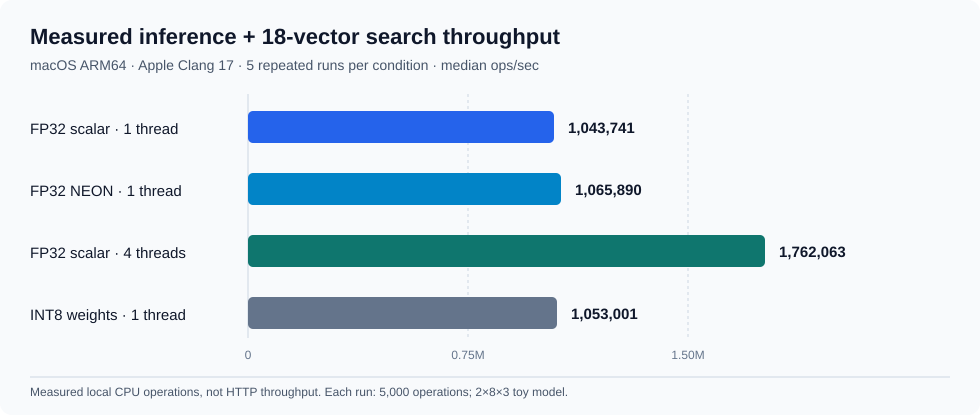
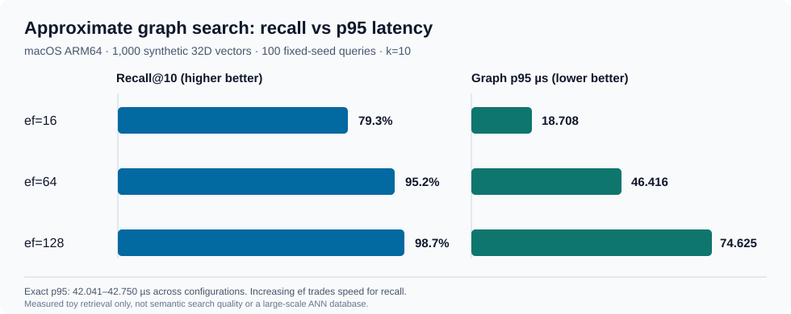

# Observed macOS ARM64 benchmark — CortexLite v1.0

**Verified local measurements, not estimated performance.** Dataset collected on 2026-10-20 at 2026-10-20T10:26:46Z, with **five repeated runs per scenario (35 runs total)**. The benchmark was compiled with the **CMake-free compiler-only build** and ran on a real macOS ARM64 system. Metrics below are **medians across five run-level observations**, not pooled percentiles and not a production SLA.

## Machine and methodology

| Property | Value |
|---|---|
| OS | macOS-26.5.2-arm64-arm-64bit-Mach-O |
| CPU architecture | `arm64` (processor field `arm`; chip model not recorded) |
| Logical CPUs | 8 |
| Compiler | Apple clang version 17.0.0 (clang-1700.3.19.1) |
| Python | 3.14.5 |
| Build | `scripts/build-native.sh` (C/C++ with `-O2`), `build-native/` |
| Inference search workload | 2-input / 8-hidden / 3-output synthetic MLP, 18 reference embeddings, 12 toy evaluation points |
| Repetitions | 5 per configuration, 5,000 inference+search operations per run |
| Retrieval workload | 1,000 random 32-dimensional vectors, 100 perturbed synthetic queries, k=10, seed=42; ef=16/64/128 |

The reported **wall throughput** measures repeated native model inference plus an 18-vector search; it is **not HTTP requests/second**. Single-operation latency excludes model/dataset loading and index construction, while the throughput wall clock includes thread creation/join. p50/p95 values are per-run operation percentiles, followed by the median of those five run-level percentile values.

## Scalar vs NEON vs threads vs INT8

| Configuration | Median wall throughput (ops/s) | Operation p50 (µs) | Operation p95 (µs) | Stored model bytes |
|---|---:|---:|---:|---:|
| FP32 scalar, 1 thread | 1,043,741 | 0.833 | 0.917 | 204 |
| FP32 ARM NEON SIMD, 1 thread | 1,065,890 | 0.833 | 0.875 | 204 |
| FP32 scalar, 4 threads | 1,762,063 | 1.917 | 2.667 | 204 |
| INT8 weights, 1 thread | 1,053,001 | 0.834 | 0.917 | 128 |



- **Four FP32 scalar threads:** **1.69×** wall throughput versus the one-thread baseline (1,762,063 vs 1,043,741 ops/s). Operation p95 increased from 0.917 to 2.667 µs; parallel throughput and per-operation latency are different quantities.
- **ARM NEON SIMD:** **1.02×** baseline throughput (approximately **2.1%** higher). This small result is within the range of ordinary microbenchmark variability; **not evidence of a meaningful NEON speedup**.
- **Per-row weight-only INT8:** **1.01×** baseline throughput (approximately **0.9%** higher), with stored model weights, biases and scale arrays reduced **37.3%** (204 → 128 bytes). Activations and biases remain FP32: model parameter storage is *not* full process RSS or all intermediate memory.

## Exact vs approximate graph retrieval

| Graph search ef | Recall@10 against exact top-K | Graph p50 (µs) | Graph p95 (µs) | Exact p95 (µs) | Index build (ms) |
|---|---:|---:|---:|---:|---:|
| 16 | 79.3% | 15.500 | 18.708 | 42.041 | 20.083 |
| 64 | 95.2% | 43.000 | 46.416 | 42.750 | 20.064 |
| 128 | 98.7% | 69.042 | 74.625 | 42.250 | 20.074 |



- At **ef=16**, graph search returns **79.3%** of exact top-10 IDs on average across the 100 seeded queries, but its p95 time is lower than exact on this machine.
- At **ef=64**, graph search reaches **95.2% Recall@10**, while its median-of-runs graph p95 (46.416 µs) slightly exceeds exact p95 (42.750 µs).
- At **ef=128**, graph recall increases to **98.7%** but graph p95 becomes 74.625 µs, materially slower than exact for these 1,000 vectors.
- The queries are the **same 100 synthetic, seeded samples** in each repetition. A stable Recall@10 here is reproducibility on one dataset, **not** a generalization or confidence interval for unseen data. The index graph is **not HNSW** and uses an O(n²d) build.

## Linux container context — not a machine ranking

The earlier Linux [results](results.md) were measured on a different **shared x86_64 container, with a different compiler/toolchain and different CPU scheduling conditions**. The macOS values use Apple Clang 17 and ARM NEON; Linux used Debian g++ 14.2 and x86 SSE2. Although the synthetic workload configuration is nominally the same, **absolute ops/sec or microsecond figures must not be used to rank Apple Silicon against Linux hardware or infer architecture superiority**.

| Condition | macOS ARM64 median ops/s | Linux x86_64 shared-container median ops/s |
|---|---:|---:|
| FP32 scalar, 1 thread | 1,043,741 | 1,736,958 |
| FP32 SIMD, 1 thread | 1,065,890 | 1,606,620 |
| FP32 scalar, 4 threads | 1,762,063 | 3,627,834 |
| INT8 weights, 1 thread | 1,053,001 | 1,515,203 |

Within their own systems, four-thread vs scalar-one-thread ratios were **1.69× on macOS** versus **2.09× on Linux**. These are **two local experimental observations**, not hardware-normalized speedups.

## Reproduction and provenance

```bash
# From the repository root; works without CMake on macOS.
bash scripts/build-native.sh

python3 scripts/run_benchmarks.py \
  --binary build-native/cortexlite \
  --vector-binary build-native/cortexlite_vector_benchmark \
  --repetitions 5 \
  --iterations 5000 \
  --vectors 1000 \
  --output reports/benchmarks-mac-local.json
```

- [**35 individual Mac runs — JSON**](../reports/benchmarks-macos-arm64-20261020.json)
- [**35 individual Mac runs — CSV**](../reports/benchmarks-macos-arm64-20261020.csv)
- [Linux raw measurements](../reports/benchmarks-linux-container.json) and [methodology](benchmarks.md)

The uploaded JSON and CSV were checked for **all 35 matching measurements**. On publication, **only the executable paths in JSON `command` arrays were changed** from absolute local filesystem paths to equivalent repo-relative `build-native/...` paths to avoid exposing a workstation account pathname; a publication note records this normalization. **The 35 test IDs, run numbers, measurement fields, timings, and host/compiler metadata are unchanged.** The public CSV reproduces exactly those numeric measurement values.

### Limitations

- Timing is sensitive to OS scheduling, performance/power mode, cache behavior, and background load; no thermal/power logging, core pinning, clock control, chip-model identification or confidence-interval experiment was recorded.
- **1,000 random vectors** are not a real document retrieval dataset. The MLP is a **2×8×3 toy classifier**. Evaluation accuracy of 1.0 on 12 hand-picked test examples is not real-world generalization.
- Graph search is performed after exact search in the same loop; cache warmth can affect side-by-side timings.
- No production serving, large-model quantization, integer-only kernels, or scalable ANN index is benchmarked. A few-percent throughput difference should not be treated as a robust performance win.
